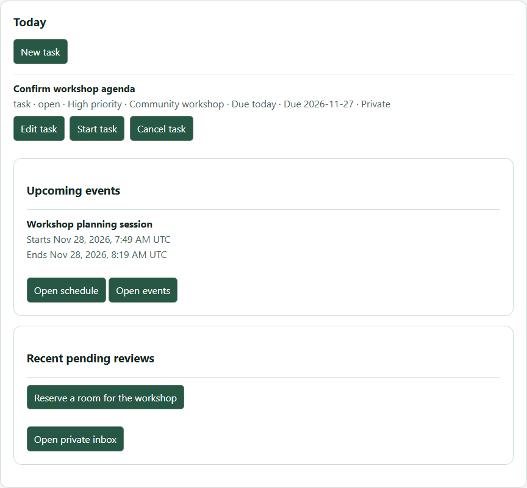
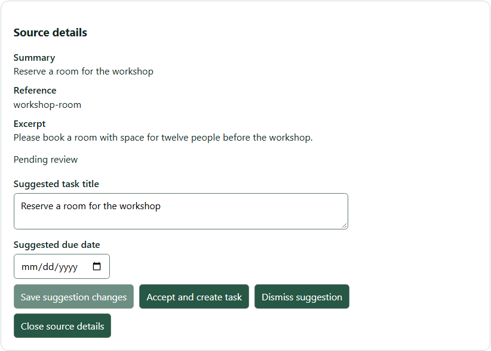
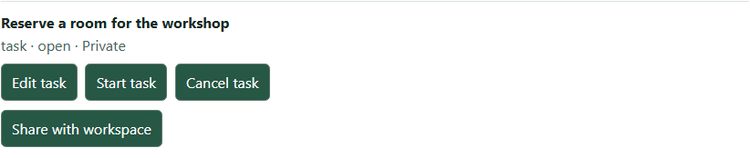

# From a workshop request to a private task

This walkthrough follows one synthetic request through a signed-in local
FlowPilot workspace. You can browse the screenshots here or try the same
sequence in the [interactive preview](0040-local-workspace-preview.md).

### 1. Find the request on Today

Under **Recent pending reviews**, select **Reserve a room for the workshop**.
The agenda task above it is already open. The room request still needs a decision.



### 2. Check what was asked

The private source asks for space for twelve people. Read the excerpt, then
choose **Accept and create task**. You can also edit the suggestion and save
your changes, or dismiss it.



### 3. Find the task in Work items

Choose **Go to work list**. The room task is **open** and **Private**.
The user can now schedule it, start it, or review it for sharing.



### Reproduce the demo

The preview seeds a manual source and requests a pending suggestion using
the signed-in session in its disposable PostgreSQL schema. The interactive
run stops on Today so the visitor can make the decision. The headless run
clicks through the same controls and checks the accepted proposal's source
ID, the resulting task in Work items, and its stored title and visibility.

With the [preview prerequisites](0040-local-workspace-preview.md) running,
use these settings in PowerShell to regenerate the three panel captures:

```powershell
.venv\Scripts\python.exe -m playwright install --only-shell chromium
$env:FLOWPILOT_INTERACTIVE_PREVIEW = '0'
$env:FLOWPILOT_CAPTURE_PREVIEW = '1'
.venv\Scripts\python.exe -m pytest -q --basetemp .tools\demo-preview-temp tests/workspace_preview.py
```

Chromium writes the PNGs under `.tools/preview-images`. The published copies
show synthetic data from one run. Dates reflect the time of capture. Live
Railway sign-in and provider imports remain separate pilot milestones.
